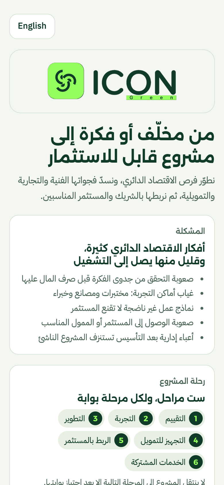
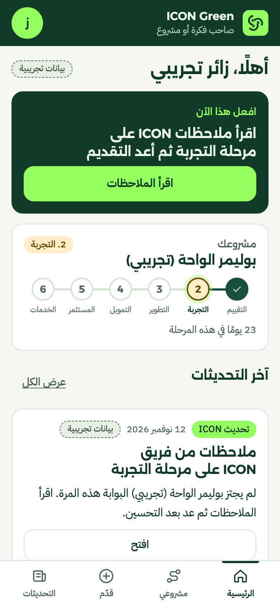
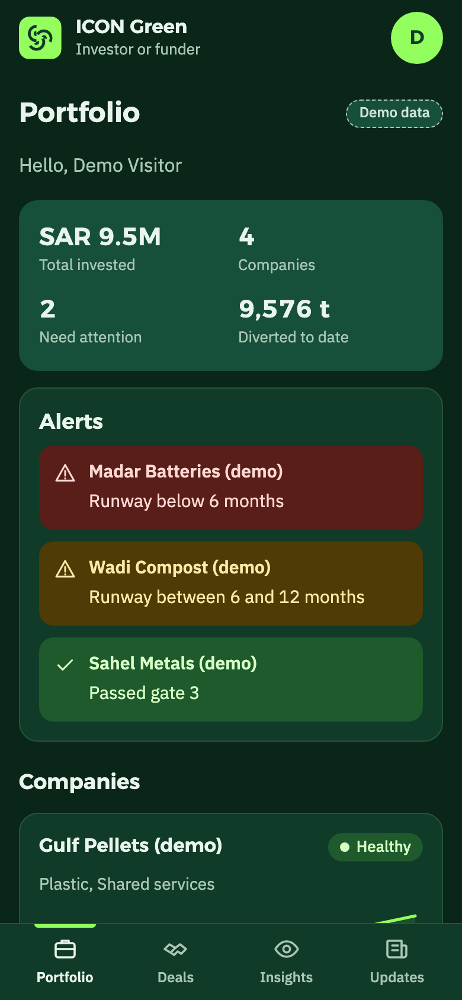
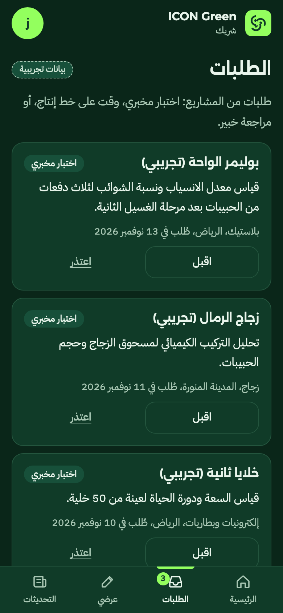
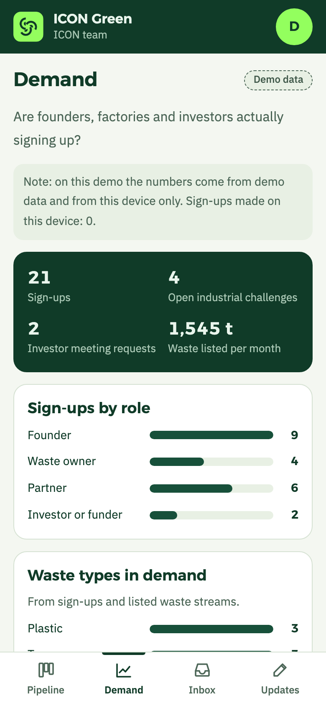
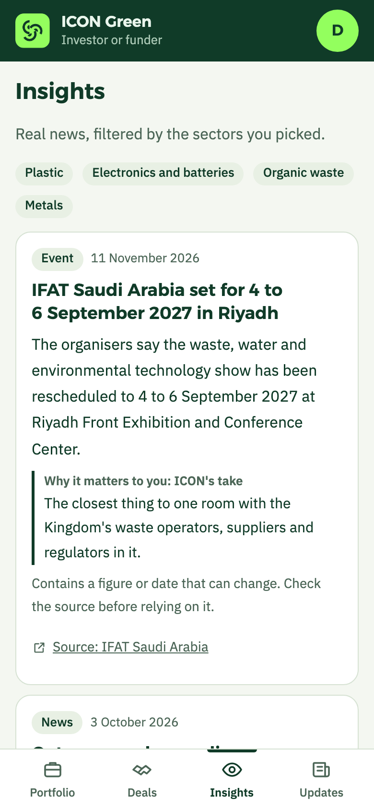
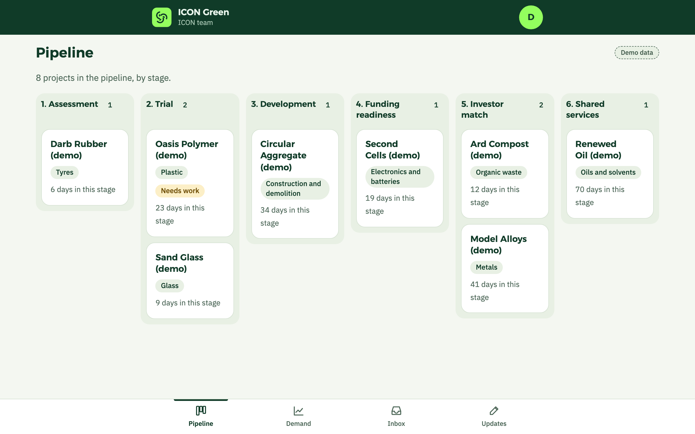

<div align="center">


### From waste or an idea to an investable project

One app for everyone in the ICON Green ecosystem: founders, waste owners, partners, investors and the ICON team.

[](https://yazan-hammad0.github.io/ICON-Green/)


%20%2B%20English-93FF5E?labelColor=103B28)
[](https://github.com/Yazan-hammad0/ICON-Green/actions/workflows/check.yml)

</div>

---

> [!IMPORTANT]
> **This is a demo.** There are no real projects, partners or investors in it yet. Every company, person, number and project is invented and labelled "بيانات تجريبية / Demo data" in the app. Only the news items are real, and each one links to its source. Sign-in has no password and nothing leaves your device.

## What it is

ICON Green is a virtual incubator, accelerator and venture studio for recycling and the circular economy in Saudi Arabia. It sits between two sides that do not speak the same language: a person with an idea or a waste problem, and an investor who will not fund an unfinished idea. A project moves through six stages, and each stage has a gate.

| # | Stage | Gate |
|---|---|---|
| 1 | Assessment · التقييم | Assessment passed |
| 2 | Trial · التجربة | Trial succeeded |
| 3 | Development · التطوير | Proven feasibility |
| 4 | Funding readiness · التجهيز للتمويل | Ready file |
| 5 | Investor match · الربط بالمستثمر | Company formed |
| 6 | Shared services · الخدمات المشتركة | Ongoing, no gate |

This app is the first working version of that journey: mobile first, Arabic first and right to left, installable to the home screen, and usable offline.

## Screenshots

<table>
  <tr>
    <td></td>
    <td></td>
    <td></td>
  </tr>
  <tr>
    <td align="center">Welcome</td>
    <td align="center">Founder: do this next</td>
    <td align="center">Investor: portfolio health</td>
  </tr>
  <tr>
    <td></td>
    <td></td>
    <td></td>
  </tr>
  <tr>
    <td align="center">Partner: requests</td>
    <td align="center">Team: demand panel</td>
    <td align="center">Real news with sources</td>
  </tr>
</table>



## Try it in one minute

1. Open the **[live demo](https://yazan-hammad0.github.io/ICON-Green/)** on your phone or laptop.
2. Tap **ابدأ / Get started**, pick a role, type any name.
3. Tap the round button at the top to open the profile. **Switch role (demo)** shows the app as each side sees it. The language switch is there too.

To install it on a phone: iPhone Safari, Share, then Add to Home Screen. Android Chrome, the ⋮ menu, then Add to Home screen. The app shows these steps after sign-in.

## One app, five roles

| Role | Tabs | What to look at |
|---|---|---|
| **Founder** · صاحب فكرة | Home, My project, Submit, Updates | The single "do this next" step, the six-gate route, a tickable gate checklist, feedback from ICON when a gate is not passed |
| **Waste owner** · صاحب مخلفات | Home, My waste, Solutions, Updates | Add a waste stream, post it as an industrial challenge, see pipeline projects that work on your waste type |
| **Partner** · شريك | Home, Requests, My offer, Updates | Requests for lab tests, line time or expert reviews that match your type. Accept or decline. Set capacity and pricing model |
| **Investor** · مستثمر | Portfolio, Deals, Insights, Updates | Health pill per company, alerts, revenue chart, deal flow of projects that passed gate 4, "Request a meeting" |
| **ICON team** · فريق ICON | Pipeline, Demand, Inbox, Updates | Board by stage, pass a gate or send feedback, the demand panel, and writing updates for chosen roles |

What one role does shows up for the others. A founder's submission lands in the team pipeline. A gate passed by the team moves the founder's route. An investor's meeting request and a partner's reply land in the team inbox.

### Investor health rules

| Pill | Rule |
|---|---|
| Red | Runway under 6 months, or revenue fell 3 months in a row |
| Amber | Runway 6 to 12 months, or no update for 45 days |
| Green | Otherwise |

## How it is built

No framework, no build step, no dependencies shipped to the browser. GitHub Pages serves this folder as it is.

```
index.html              the page: header, main, tab bar
manifest.webmanifest    home-screen app settings
sw.js                   offline cache (version stamped by release.py)
release.py              stamps a new version so installed apps update
robots.txt              disallows all crawlers (this is a team demo)
css/app.css             all styles, light and dark, logical properties for RTL
js/
  brand.js              every logo reference, in one place
  i18n.js               every string, Arabic and English, plus the six stages
  store.js              the only file that reads or writes data
  ui.js                 helpers: formatting, icons, forms, route, line chart
  app.js                routing, header, tab bar, profile
  news.js               news cards and the updates feed
  auth.js               welcome and demo sign-in
  onboard.js            install guide
  founder.js  waste.js  partner.js  investor.js  team.js   one file per role
  shell.js              screen-tall layout for the home-screen app, update card
data/
  projects.json  waste.json  partners.json  investors.json  activity.json   demo data
  news.json             real news, each item checked against its source
fonts/                  Alexandria and IBM Plex Sans Arabic, self-hosted (OFL.txt)
icons/                  logo, icon and home-screen icons
tools/                  check.js (fast checks) and walk.js (browser walk-through)
docs/                   architecture notes and screenshots
```

More detail: [docs/ARCHITECTURE.md](docs/ARCHITECTURE.md).

## Run it locally

You need Python 3 (for a simple web server). Node.js is only needed for the checks.

```bash
git clone https://github.com/Yazan-hammad0/ICON-Green.git
```

```bash
cd ICON-Green
```

```bash
python3 -m http.server 8765
```

Then open http://localhost:8765. Or skip git: on GitHub press **Code**, then **Download ZIP**, unzip, and run the last command inside the folder.

## Checks and tests

Fast checks, no install needed (strings in both languages, no em dashes, valid data, service worker list):

```bash
node tools/check.js
```

Full walk-through in a real browser. It signs in as every role and walks every tab at iPhone and desktop size, in Arabic and English, light and dark, in the browser and in home-screen mode, and fails on any page error, console error, horizontal scroll or touch target under 44 px:

```bash
npm install --no-save playwright && npx playwright install chromium
```

```bash
node tools/walk.js http://localhost:8765/ /tmp/icon-green-shots
```

## Changing the demo data

All demo records live in `data/*.json`. Edit, save, reload.

- **Names must look invented.** Arabic names contain "تجريبي", English names contain "demo". `tools/check.js` enforces it.
- **Give ages, not dates.** `"since_ago": 23` means 23 days ago. The store turns ages into dates on load, so the demo never looks stale. Any key that ends in `_ago` works this way.
- **Both languages.** Text fields come in pairs: `name_ar` and `name_en`, `problem_ar` and `problem_en`.
- **Personas.** `data/activity.json` says which demo records belong to the signed-in user of each role.
- Changes made inside the app are saved in the browser under `iconGreenV1`. "Reset demo data" in the profile clears them.

## Adding news

Add an item to `data/news.json` and push. No release is needed for news alone: the app fetches the file fresh when online and keeps the last copy for offline use.

Every item must be real, dated and linked, and someone must open the link and check that it says what the summary says. If it cannot be checked, leave it out. Items with a figure or date that can change carry a `recheck` note. The fields are listed in [docs/ARCHITECTURE.md](docs/ARCHITECTURE.md#news).

## Swapping in a real backend

Screens never touch storage. They call `Store.getProjects()`, `Store.saveProject()`, `Store.signIn()` and so on. To move to Supabase or a Cloudflare Worker, keep those names and what they return, and replace three private pieces inside `js/store.js`:

1. `load()`: fetch the collections from the API instead of `data/*.json`.
2. `put()`: send the record to the API instead of localStorage.
3. The user functions: real sign-in instead of the demo one.

The steps are written out in [docs/ARCHITECTURE.md](docs/ARCHITECTURE.md#moving-to-a-real-backend).

## Releasing a change

```bash
python3 release.py "One line on what is new"
```

Then commit and push. Without the stamp, installed apps never notice the change. Pages deploys in about a minute.

## Roadmap

- [ ] Real accounts and a backend behind `js/store.js`
- [ ] Final logo files from the designer (drop into `icons/`, same names)
- [ ] Editable assessment scores for the team, with agreed weights
- [ ] Notifications when a gate is passed or feedback arrives
- [ ] Review of the Arabic copy by the team
- [ ] Contact details and the market survey link

## Status and honesty

- The business model, prices and partners are not final. The app never shows prices.
- No organisation named in the news is an ICON Green partner.
- Stage 1 score weights are provisional.
- The demand panel only counts demo data and sign-ups made on the same device.

## Licence

Copyright © 2026 ICON Green. All rights reserved. See [LICENSE](LICENSE). The fonts in `fonts/` are under the SIL Open Font License 1.1 (see `fonts/OFL.txt`).
